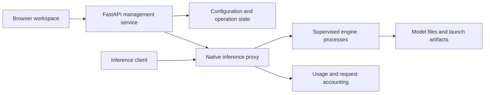

# Studio

Studio is a browser-based workspace for acquiring models, managing inference engines, configuring model runtimes, and serving local inference through a native proxy. It combines a Vue 3 frontend, a FastAPI management service, persistent local configuration, and supervised engine processes.

## Documentation

| Guide                                                        | Contents                                                                                                                                                |
| ------------------------------------------------------------ | ------------------------------------------------------------------------------------------------------------------------------------------------------- |
| [Delivery map](docs/delivery-map.md)                         | Review/ship entry point for the config-driven engine definitions release: gains, architecture, compatibility, changes, verification limits, remaining work. |
| [Change inventory](docs/change-inventory.md)                 | Dependent commit series, file boundaries, deletions and their replacements, test placement.                                                              |
| [Feature guide](docs/features.md)                            | Complete workspace guide: engines, acquisition, configuration, aliases, runtime state, audio, access policies, System, backup, history, and benchmarks. |
| [API reference](docs/api-reference.md)                       | Management endpoint catalog, request/response schemas, inference interfaces, examples, authorization, and error semantics.                              |
| [Proxy operations](docs/proxy-operations.md)                 | Routing, request observation, keys, budgets, queues, timeouts, process supervision, and accounting storage.                                             |
| [Runtime architecture](docs/launch-manifests-plan.md)        | Desired/published/running revisions, command compilation, per-model and batch application, rollback, and reconciliation.                                |
| [Runtime behavior cases](docs/launch-manifests-use-cases.md) | Concrete save/apply, routing, cancellation, and recovery behavior.                                                                                      |
| [Audio contract and discovery](docs/audio-cpp-discovery.md)  | Engine/model metadata, task routing, typed options, voices, and audio transport.                                                                        |
| [Engineering reference](docs/current-engineering-status.md)  | Persistence, authorization boundaries, operations, source modules, and reproducible quality checks.                                                     |
| [Documentation index](docs/README.md)                        | Navigation across the current reference documentation.                                                                                                  |

## Workspaces

- **Models** provides card/table views, filtering, sorting, runtime actions, Connect, file inspection, configuration, warm-up, and deletion.
- **Search** discovers Hugging Face models and normalized audio packages, selects artifacts/quantizations/companions, and starts downloads or package installs.
- **Audio** runs speech, transcription, and discovered generic tasks with the selected model's request schema, voices, reference assets, and outputs.
- **Engines** manages runtime installations, source builds, installed versions, activation, build settings, updates, and parameter scans.
- **Proxy** exposes traffic, engine health, logs, keys and client policies, live routing aliases, serving limits, and gateway lifecycle.
- **System** contains Hardware, Diagnostics, Backup & restore, and Change history. Hardware owns CPU/memory/disk/GPU readings and CUDA installation/version controls.

Model configuration stores a separate section per engine. Forms use discovered flags, defaults, enums, types, and model-specific metadata. Command import understands scalar, multi-value, repeated, JSON, and delimited parameters. Native command previews include ordered arguments, environment details, launch revisions, and generated sidecars.

### Supported engines

| Engine            | ID              | Artifacts                                                | Installation                                             |
| ----------------- | --------------- | -------------------------------------------------------- | -------------------------------------------------------- |
| llama.cpp         | `llama_cpp`     | GGUF                                                     | Source/CMake build.                                      |
| ik_llama.cpp      | `ik_llama`      | GGUF                                                     | Source/CMake build.                                      |
| Unsloth llama.cpp | `unsloth_llama` | GGUF                                                     | Published prebuilt distribution.                         |
| LMDeploy          | `lmdeploy`      | safetensors snapshots                                    | Managed Python environment.                              |
| 1Cat-vLLM         | `1cat_vllm`     | safetensors snapshots                                    | Managed Python environment.                              |
| vLLM              | `vllm`          | safetensors snapshots                                    | Managed Python environment.                              |
| SGLang            | `sglang`        | safetensors snapshots                                    | Managed Python environment.                              |
| SGLang V100       | `sglang_v100`   | safetensors snapshots                                    | Dedicated source/build workflow and managed Python/CUDA. |
| audio.cpp         | `audio_cpp`     | Prepared audio packages and discovered audio GGUF models | Source/CMake build.                                      |

Available tasks and hardware support depend on the installed engine and selected model. Studio reads the engine registry, executable help, and structured metadata to expose applicable controls.

### Native serving and aliases

The native proxy owns routing, engine process generations, readiness, streaming, cancellation, access policy, request accounting, and lifecycle. Ordinary API aliases identify a real model. Named request presets such as `assistant:no-thinking` apply JSON request overrides while sharing that model's process. Live routing aliases can select a single target or distribute requests round-robin across an ordered target list.

Saving engine configuration records desired settings. Publishing selects an immutable launch revision. **Restart this model** applies a launch to that running model; **Use on next start** publishes the launch for its next actual start. Other models keep running. API aliases/request presets update through native routing for subsequent requests. Proxy serving-limit changes use **Restart & apply**, which drains the proxy's engine processes.

Read [model identity and aliases](docs/features.md#model-identity-and-aliases) and [saving, publishing, and running](docs/features.md#saving-publishing-and-running) for exact configuration and state semantics.

## Ports and architecture

| Interface                 | Container/production default         | Local development default            |
| ------------------------- | ------------------------------------ | ------------------------------------ |
| Browser UI                | `http://localhost:8080`              | `http://localhost:5173`              |
| Management API            | `http://localhost:8080/api`          | `http://localhost:8081/api`          |
| Native inference          | `http://localhost:2000`              | `http://localhost:2000`              |
| Interactive API reference | `http://localhost:8080/docs`         | `http://localhost:8081/docs`         |
| Running OpenAPI schema    | `http://localhost:8080/openapi.json` | `http://localhost:8081/openapi.json` |

Vite forwards `/api` and `/v1` to the management backend. Inference clients normally use the native inference origin. The management origin also supplies audio/task transport routes. The public inference URL shown in Connect is a client-facing setting, separate from listener binding.



The backend starts the inference listener when a registered runtime is active. Models load through explicit start/preload or inference demand. Engine readiness can include substantial weight-loading and device-initialization time.

## Setup

### Frontend build configuration

The production frontend build requires `VITE_PRIMEUI_LICENSE`. Vite consumes this value during the build. Set it in `frontend/.env.local`, provide it as a Docker build argument, or put it in the repository-root `.env` for Compose build-argument interpolation:

```dotenv
VITE_PRIMEUI_LICENSE=YOUR_LICENSE_VALUE
```

### Docker CPU setup

From the repository root:

```bash
docker compose -f docker-compose.cpu.yml up --build
```

The CPU Compose configuration mounts `./data` at `/app/data`, publishes the UI/API and inference ports on host loopback, mounts the backend source, and enables backend reload. The browser receives the frontend bundle built into the image.

### Docker NVIDIA setup

The host needs an NVIDIA driver and NVIDIA Container Toolkit suitable for the selected workloads:

```bash
docker compose -f docker-compose.cuda.yml up --build -d
```

This configuration publishes the same loopback ports, mounts the persistent data directory, reserves NVIDIA GPUs, and disables backend reload. CUDA toolkit installation/version management is available in **System → Hardware**.

### Manual container build

```bash
docker build \
  --build-arg VITE_PRIMEUI_LICENSE="$VITE_PRIMEUI_LICENSE" \
  -t llama-cpp-studio .

docker run -d \
  --name llama-cpp-studio \
  -p 127.0.0.1:8080:8080 \
  -p 127.0.0.1:2000:2000 \
  -v "$(pwd)/data:/app/data" \
  llama-cpp-studio
```

Add `--gpus all` for NVIDIA device access. The persistent data mount needs write permission for the container's configured user.

### Local development

Requirements are Node.js 24+, Python 3.12, and the native build dependencies needed for the engines you use. Typical Linux source-build tooling includes Git, CMake, a C/C++ toolchain, pkg-config, and applicable BLAS/device libraries.

```bash
python3.12 -m venv .venv
source .venv/bin/activate
pip install -r requirements-dev.lock
npm ci
npm run dev:all
```

The npm backend scripts invoke `python`, so activate the environment before running them. Separate terminals can use `npm run dev:frontend` and `npm run dev:backend`.

For a production-style local run:

```bash
source .venv/bin/activate
npm run build
python backend/main.py
```

The FastAPI service serves `frontend/dist`. The default persistent data root is `./data` on the host and `/app/data` in the container. `STUDIO_DATA_DIR` selects an explicit data root.

#### Linux dev container

For development on the repository itself inside Linux, run the repo-mounted long-lived dev container built from the runtime stage of the `Dockerfile`:

```bash
docker compose -f docker-compose.dev.yml up -d --build
docker compose -f docker-compose.dev.yml exec studio-dev bash
```

The repository is mounted at `/app`. Each container start installs `requirements-dev.lock` into the image venv; `npm ci` runs once into a named volume so a host `node_modules` is never used inside. In the container the commands above work as written: `npm run dev:all`, `npm run test`, `python -m pytest backend/tests -q`, lint, and `npm run openapi:check`. Ports `5173`, `8080`, `8081`, and `2000` are published to host loopback, and `.devcontainer/` attaches VS Code Dev Containers to the same service.

Two caveats when testing in the dev container: run the backend suite as the image's unprivileged user (`exec --user appuser studio-dev`), because a root shell bypasses the permission bits that the rustup-home relocation tests exercise; and build the frontend once (`npm run build`) before `test_performance_budgets.py`, which inspects the production bundle.

#### Remote development stack for agents

For work against the actual GPU host without touching the live instance, use the
separate checkout/state/ports stack described in
[Remote development stack for agents](docs/agent-dev-stack.md):

```bash
sudo bash scripts/agent-dev/provision-host.sh --user studioagent --ssh-key-file agent.pub --repo-url <clone-url>
ssh studioagent@dev-host 'agent-dev stack build && agent-dev stack up'
ssh studioagent@dev-host 'agent-dev inspect-instance --json'
```

It mounts a separate checkout into a dev container with Uvicorn reload and Vite
HMR, exposes a JSON CLI and an MCP stdio transport over SSH, and provides guarded
patch, test, log, reload, diagnostics, and rollback operations with an operation
ID and revision on every result. It is independent of the local
`docker-compose.dev.yml` container and is not included in production images. For a completely host-free option, use the
[self-contained development image](docs/agent-dev-standalone.md): one container,
named volumes, SSH/MCP, and no Docker socket.

```bash
scripts/agent-dev/build-standalone.sh
docker compose -f scripts/agent-dev/standalone.compose.yaml up -d
docker cp agent.pub studio-dev:/state/authorized_keys
ssh -p 2222 agent@dev-host
```

The host-assisted controller path is optional; the standalone image is the
Docker-socket-free option.

## First model workflow

1. Open **Engines**, install/build a runtime suitable for the model, and activate its version.
2. Open **System → Hardware** when toolkit installation or hardware inspection is needed.
3. Configure a Hugging Face token when the selected model requires provider access.
4. Open **Search**, select a model/artifact/package, and acquire it.
5. Open the model's configuration, select its engine, review parameters/assets, and save.
6. Use the runtime plan's **Restart this model** or **Use on next start** action when a launch revision needs publication.
7. Start the model, or let an inference request trigger loading. Wait for readiness.
8. Open **Connect** for the API URL, model ID, access key, request example, and test action.
9. Inspect **Proxy** for client policy, request outcomes, engine logs, and usage.

For audio models, the configuration exposes family/task, assets, request defaults, and launch controls. **Open Audio** selects the model in the Audio workspace. The model's contract supplies supported task panels and request options.

## Inference examples

When no inference keys exist and anonymous inference is enabled:

```bash
curl http://localhost:2000/v1/models

curl http://localhost:2000/v1/chat/completions \
  -H 'Content-Type: application/json' \
  -d '{"model":"MODEL_ID_FROM_CATALOG","messages":[{"role":"user","content":"Say hello."}]}'
```

For an authenticated client, add `-H "Authorization: Bearer $STUDIO_INFERENCE_KEY"`. Inference keys are distinct from the management token.

The management origin exposes supported audio transports:

```bash
curl http://localhost:8080/v1/audio/speech \
  -H "Authorization: Bearer $STUDIO_INFERENCE_KEY" \
  -H 'Content-Type: application/json' \
  -d '{"model":"AUDIO_MODEL_ID","input":"Hello from Studio","voice":"default"}' \
  --output speech.wav

curl http://localhost:8080/v1/audio/transcriptions \
  -H "Authorization: Bearer $STUDIO_INFERENCE_KEY" \
  -F model=ASR_MODEL_ID \
  -F file=@sample.ogg
```

The selected engine/model determines voices, accepted formats, and supported routes. Applicable upload/output conversions follow the audio contract. See [audio endpoints](docs/features.md#audio-endpoints) and the [API reference](docs/api-reference.md).

## Persistent data

| Location under the data root                                                                                | Contents                                                                                    |
| ----------------------------------------------------------------------------------------------------------- | ------------------------------------------------------------------------------------------- |
| `config/models.yaml`                                                                                        | Model catalog, file ledgers, review metadata, and per-engine configuration.                 |
| `config/engines.yaml`                                                                                       | Installed/active engine versions and build/install settings.                                |
| `config/settings.yaml`                                                                                      | Service preferences, provider configuration, and native proxy settings.                     |
| `config/engine_params_catalog.yaml`                                                                         | Discovered engine parameters and profile metadata.                                          |
| `config/model_config_templates.yaml`                                                                        | Reusable configuration templates.                                                           |
| `config/inference_keys.yaml`                                                                                | Inference-key policy and secret digests.                                                    |
| `config/operations.yaml`                                                                                    | Durable operation state.                                                                    |
| `config/config_restore.yaml`                                                                                | Portable-restore journal when a restore is in progress.                                     |
| `config/benchmarks.yaml`                                                                                    | Local model benchmark results.                                                              |
| `config/history/`                                                                                           | Private configuration snapshots.                                                            |
| `config/proxy-accounting.sqlite3` and associated WAL files                                                  | Client usage, reservations, request metadata, and statistics state.                         |
| `runtime/models/`                                                                                           | Immutable launch generations, published pointers, runtime receipts, journals, and sidecars. |
| `models/`, `hf-cache/`                                                                                      | Model artifacts and provider cache.                                                         |
| `llama-cpp/`, `unsloth-llama/`, `lmdeploy/`, `1cat-vllm/`, `vllm/`, `sglang/`, `sglang-v100/`, `audio-cpp/` | Engine sources, builds, environments, or distributions.                                     |
| `cuda/`                                                                                                     | Managed CUDA toolkit installations and active path.                                         |
| `logs/`, `temp/`                                                                                            | Background/install logs and temporary work.                                                 |

Portable configuration export contains selected preferences, model settings, and templates. It does not contain the entire operational data volume. Keep the data directory private and use an appropriate SQLite backup procedure for a running accounting ledger. [Backup and history details](docs/features.md#portable-backup-and-restore) describe exact inclusion, preview, and recovery behavior.

## Environment configuration

| Variable                           | Meaning                                                                                           |
| ---------------------------------- | ------------------------------------------------------------------------------------------------- |
| `STUDIO_DATA_DIR`                  | Explicit persistent data root.                                                                    |
| `HUGGINGFACE_API_KEY`              | Provider credential for authenticated/gated discovery and downloads.                              |
| `HF_HOME`, `HUGGINGFACE_HUB_CACHE` | Hugging Face cache locations.                                                                     |
| `HF_HUB_ENABLE_HF_TRANSFER`        | Transfer acceleration preference when supported by the installed provider stack.                  |
| `CUDA_VISIBLE_DEVICES`             | Process-visible NVIDIA indices/UUIDs in the intended order. Leave unset for inherited visibility. |
| `RELOAD`                           | Backend reload toggle.                                                                            |
| `STUDIO_ACCESS_MODE`               | `local` or `remote` management access mode.                                                       |
| `STUDIO_API_TOKEN`                 | Management bearer/session-login token. Remote mode can also use the private token file.           |
| `STUDIO_BIND_HOST`                 | Management listener address; host default is loopback and container default is all interfaces.    |
| `STUDIO_PROXY_LISTEN`              | Native inference listener address with the same host/container default pattern.                   |
| `BACKEND_CORS_ORIGINS`             | Management CORS origin configuration.                                                             |
| `BACKEND_CORS_ALLOW_CREDENTIALS`   | Management credentialed-CORS toggle.                                                              |
| `VITE_DEV_HOST`                    | Vite development listen address.                                                                  |
| `VITE_PRIMEUI_LICENSE`             | Required production frontend build value.                                                         |
| `CPU_ONLY_MODE`                    | CPU-only hardware-detection intent.                                                               |
| `AUDIO_CPP_ENABLED`                | Audio integration toggle; enabled by default.                                                     |
| `LMDEPLOY_BIN`                     | Optional LMDeploy executable override.                                                            |
| `CMAKE`, `CMAKE_EXECUTABLE`        | Source-build CMake executable selection.                                                          |
| `STUDIO_BUILD_THREADS`             | Override CMake/build parallelism; default is every CPU the process may use.                       |
| `STUDIO_BLOCKING_WORKERS`          | Size the shared pool that runs blocking probes/scans off the API event loop.                      |

`proxy_port` and the client-facing public inference URL are application settings. The port takes effect at listener restart; the public URL supplies client examples and connection details. TLS termination belongs at the deployment's reverse proxy.

## Validation and development tools

```bash
source .venv/bin/activate
npm run test:frontend
python -m pytest backend/tests -q
npm run lint
npm run typecheck:api
npm run style:check
npm run format:check
npm run openapi:check
npm run build
npm run test:browser
```

The repository contains real CPU fixture tests for native HTTP/SSE transport and process supervision, plus browser journeys for navigation, layout, accessibility assertions, configuration, and client workflows. Individual GPU/model combinations require the matching hardware/runtime and inference checks.

`VERSION` supplies application version metadata. The checked-in OpenAPI schema reflects the management API. CI runs the configured code/schema/version checks, dependency audits, and container/image workflows. See [engineering reference](docs/current-engineering-status.md) for commands, source ownership, recovery boundaries, and environment-dependent checks.

## Troubleshooting

| Symptom                                              | Checks and actions                                                                                                                                                              |
| ---------------------------------------------------- | ------------------------------------------------------------------------------------------------------------------------------------------------------------------------------- |
| Engine does not install/build                        | Inspect the task/build log, selected source/ref/package, compiler/dependencies, available storage, and applicable device/toolkit prerequisites.                                 |
| Model cannot start                                   | Check active compatible engine, complete artifacts/companions, reviewed saved configuration, valid runtime plan, and proxy health. Inspect model logs and the operation result. |
| Saved launch settings are not in use                 | Read the model's runtime plan and published/running revisions; invoke the appropriate per-model action.                                                                         |
| Request alias does not change behavior               | Verify the exposed name, preset JSON path, target engine's parameter support, and use of a JSON inference route.                                                                |
| HTTP 429                                             | Inspect the policy/queue reason, reservations, limits, and Retry-After value in Proxy request details.                                                                          |
| Audio task is unavailable                            | Inspect the selected task/family contract and model profile; rescan the engine/model metadata when required.                                                                    |
| Hardware readings are unknown                        | Refresh System → Hardware and inspect diagnostic/probe errors. Missing readings do not measure zero usage.                                                                      |
| Save/restore response is uncertain                   | Retain the draft, refresh/reconcile authoritative state, and follow the returned outcome instead of replaying a mutation automatically.                                         |
| Data directory is not writable                       | Check mount ownership and access for Studio's runtime user.                                                                                                                     |
| Frontend build reports a license configuration error | Supply `VITE_PRIMEUI_LICENSE` to the frontend build environment.                                                                                                                |
