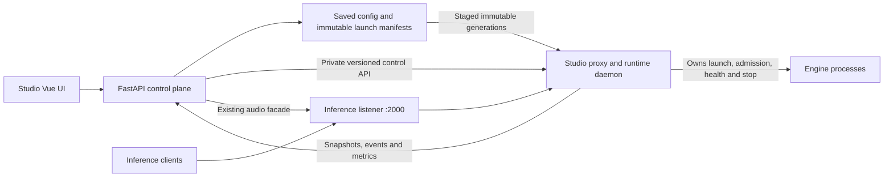

# Studio proxy replacement: architecture, delivery plan, and estimate

Proposed 2026-10-21 against repository commit `c5ddacf`. This is a planning document; no proxy implementation or deployment change is included.

Build a Studio-owned Go proxy/runtime daemon, retain Python as the configuration and engine-management control plane, and integrate operations and inspection into the existing Vue application. Reuse the implemented launch compiler, immutable manifests, engine adapters, and recovery contracts. Make routing changes independent of engine process replacement.

**Planning budget: 30–42 engineer-weeks, approximately 14–20 calendar weeks with three experienced engineers.** A text-only internal alpha should be possible during weeks 4–6. Production replacement includes all nine registered engine variants, existing audio workflows, recovery, observability, packaging, and a reversible migration. These are engineering estimates, not measured delivery forecasts; re-estimate after the first two weeks.

“Inspectful” is interpreted as inspectable and explainable: an operator can determine why a request selected a model, where time was spent, which configuration and process served it, and why it failed.

## Repository findings that determine scope

| Finding | Consequence | Evidence |
| --- | --- | --- |
| The container pins llama-swap v265; older plans describe v255/v260. | Use v265 as the compatibility baseline. | [Dockerfile](../Dockerfile), install block around line 209 |
| There are nine engine variants, including Unsloth llama.cpp. | Release validation must cover the current registry rather than an older eight-engine matrix. | [Engine registry](../backend/engines/registry.py) |
| Launch manifests are implemented and default-on. | Reuse structured argv/environment/artifacts and desired/published/running revisions. | [Feature flag](../backend/feature_flags.py), [launch specs](../backend/proxy/launch_spec.py), [manifest store](../backend/proxy/manifests.py), [launcher](../backend/proxy/launcher.py) |
| Launch compilation still imports helpers from the llama-swap module. | Extract shared compilation before removing that package. | [Compiler](../backend/proxy/launch_spec.py), `compile_model_runtime` |
| Global apply unloads models, publishes files, and observes reload completion through stdout strings and health. | Replace implicit file-watch acceptance with a revision-specific control protocol. | [Manager](../backend/proxy/llama_swap/manager.py), reload-observation/apply code around lines 1222 and 1454 |
| Studio owns llama-swap through FastAPI lifespan. | Independent runtime survival requires deployment supervision changes as well as a new binary. | [Application lifespan](../backend/main.py), lines 226–278 |
| Current configuration permits concurrent models without automatic swapping. | Preserve that behavior; do not silently introduce GPU eviction. | [Configuration generator](../backend/proxy/llama_swap/config.py), `concurrent_models` |
| Some engine starts have a 45-minute budget. | Separate request deadlines, shared startup lifetime, and asynchronous operation deadlines. | [Proxy client](../backend/proxy/llama_swap/client.py), `MODEL_START_BUDGET_SECONDS` |
| Audio has native proxy routes plus a Studio conversion/compatibility facade. | Port 2000 and Studio `/v1` have distinct existing contracts to preserve. | [Audio facade](../backend/routes/audio_openai_proxy.py), [frontend client](../frontend/src/composables/useAudioInferenceClient.js) |
| Studio has apply workflows and task events, but the header links to llama-swap's separate operator UI. | Budget an integrated runtime/request inspector and inference logs. | [App header](../frontend/src/components/layout/AppHeader.vue), [progress events](../backend/operations/progress.py) |
| Backups/history contain `llama_swap_routing.yaml`; models/APIs expose vendor-named fields. | Keep compatibility readers and aliases while changing the implementation. | [Backup](../backend/config_backup.py), [history](../backend/config_history.py) |

The pinned upstream also rebuilds its server on configuration reload and shuts down the previous server. This confirms that removing Studio's unload-all call alone does not establish nondisruptive reload. See [v265 reload implementation](https://github.com/mostlygeek/llama-swap/blob/v265/llama-swap.go).

The earlier [launch-manifest plan](launch-manifests-plan.md) estimated 4–6 engineer-weeks for selective launch changes while retaining llama-swap. That estimate does not cover this replacement. Its launch invariants and [use cases](launch-manifests-use-cases.md) remain useful acceptance inputs; the new daemon replaces its proxy ownership and global-reload assumptions.

## Product contract and boundaries

The first production release should provide:

- Existing model IDs, aliases, parameter variants, profiles, selectors, advertised capabilities, and inference URLs.
- On-demand loading, explicit start/stop, concurrent serving, readiness, bounded admission queues, cancellation, optional idle expiry, and owned-process cleanup.
- Immediate activation of routing-only changes without restarting engines or interrupting admitted streams.
- Explicit “use on next start,” “drain and restart this model,” and force-restart behavior for launch changes.
- An integrated request inspector, lifecycle timeline, inference logs, route explanation, configuration impact preview, and metrics.
- Continued native inference while the Studio backend restarts; reconciliation when it returns.
- A migration preflight, controlled ownership transfer, and tested rollback to llama-swap during the transition period.

Assume Linux/Docker first, a single inference host, current engine installation mechanisms, and access to suitable GPU test machines. Preserve the configurable inference port and `public_inference_url`; default remains `:2000`. Keep the Studio audio facade on its existing origin. Native Windows/macOS process guarantees require separate scope before removing the old backend on those platforms.

Defer multi-host placement/federation, automatic VRAM prediction and eviction, distributed HA, arbitrary third-party llama-swap plugins/configuration, a separate playground clone, durable searchable prompt history, payload replay, and seamless daemon binary upgrades. Detect unsupported deployed features during migration and explain them; never silently discard them.

Configuration hot reload is part of v1. Seamless model replacement depends on available memory; seamless daemon replacement is a different capability.

## Architecture and ownership

Use Go's standard HTTP stack and `httputil.ReverseProxy` with explicit transport limits, rewrite behavior, streaming flush policy, and cancellation. The standard proxy exposes these facilities; their correct configuration and measurement remain our responsibility. See [Go ReverseProxy documentation](https://pkg.go.dev/net/http/httputil#ReverseProxy).

Go is the recommended implementation choice because a dedicated compiled daemon gives this system a clear runtime boundary and a practical HTTP/process toolchain. This is a design judgment, not a claim that language choice alone makes it faster than llama-swap, which is also Go. An isolated asynchronous Python service remains viable if Go ownership is unavailable; decide that during the initial spike and revise the maintenance/performance estimate. Rust offers no demonstrated project-specific advantage sufficient to justify a second evaluation track here.

| Component | Authoritative responsibilities |
| --- | --- |
| Python control plane | Saved configuration, engine installation/discovery, model assets, launch compilation, staging immutable artifacts, history/backup, UI authentication, user operation presentation |
| Go daemon | Accepted deployment generation, route resolution, request admission, engine processes, readiness, draining, idle expiry, live runtime state, runtime-operation execution/recovery |
| Vue application | Configuration editing, apply preview, task progress, model controls, request/runtime inspection |
| Deployment supervisor | Starts FastAPI and daemon independently, handles service restarts and whole-application shutdown, enforces one daemon owner |

Python submits an operation with an idempotency key and expected generation. The daemon owns runtime execution and its durable journal; Python's task row references that operation and mirrors its outcome. Reconnecting Python queries the same operation instead of replaying side effects. Retain current operation-admission behavior, but remove the competing Python stop/publish/start coordinator for the new backend.

Python stages immutable files; the daemon exclusively activates the deployment pointer and any compatibility model pointers while it owns the installation. Backups/history continue to modify desired state only. Define an artifact lease protocol so engine deletion and manifest garbage collection cannot remove running, staged, published, or rollback dependencies during a control-plane reconnect.

Retain the Python exec launcher initially. Add an explicit revision/launch-ID input so the daemon launches the generation selected by its snapshot, rather than rereading a mutable `active.json` after admission. Keep engine-specific command construction in one place. Cross-language contract tests must cover manifest versions, artifact hashes, environment semantics, and error handling.

The private control API should use a permission-restricted Unix socket on Linux. Proposed operations: validate/plan, commit generation, get operation, runtime snapshot, start, drain/stop, apply launch revision, route explain, and events. Use generated or checked contracts and explicit version negotiation. Public inference endpoints must not expose process-management routes.

Run the daemon as a sibling service under a host/container supervisor rather than a FastAPI-lifespan child. Existing `tini` handles reaping; it does not supply the independent supervision policy by itself. Define graceful application shutdown, backend development reload, daemon failure, and container termination separately.

## Configuration and live-reload semantics

Maintain three distinct concepts: **desired configuration**, **accepted deployment generation**, and **running launch revision**. A deployment snapshot references immutable launch generations and complete route/policy data. Keep monotonic generation IDs plus content hashes; a no-op does not publish another generation.

| Change | Required behavior |
| --- | --- |
| Alias, request defaults, selector/profile, display/capability metadata | Validate and atomically activate a routing snapshot; existing requests retain their selected route and effective settings |
| Add a valid model | Publish registration; remain stopped until requested or explicitly started |
| Remove a model/route | Block new admissions, retain existing request/process leases until drain completes, then retire it |
| Executable, argv, environment, GPU selection, launch sidecar | Publish for next start, or drain/restart only affected models |
| Concurrency/TTL policy | Apply to future admissions; a lower limit does not cancel existing work; expiry cannot stop an actively leased runtime |
| Health/protocol/upstream-model mapping changes | Classify against engine compatibility; stage with the required launch revision when coupled, rather than blindly hot-swapping |
| Invalid configuration or stale expected generation | Reject with actionable diagnostics; keep the prior accepted state |
| Listener/socket or daemon binary change | Explicit service restart in v1 |

Activation protocol:

1. Compile and stage a complete candidate with all referenced artifacts. Validate namespace collisions, alias/profile/selector rules, endpoint contracts, dependencies, and schema compatibility.
2. Produce a revision-bound plan: changed routes, affected models, drain/restart requirements, and blocking conditions. Preview and execution use the same classifier.
3. Persist the candidate and operation intent. Compare-and-swap the expected generation under a brief configuration coordinator; publish the durable active pointer and in-memory snapshot through a defined commit sequence.
4. Acknowledge the exact activated generation only after durable publication and runtime installation. If the response is lost or the process crashes between steps, operation lookup and startup reconciliation resolve the result. Health alone never proves acceptance.
5. Retain old route snapshots while requests reference them. Reclaim retired snapshots/artifacts only after their leases and rollback references expire.

A request pins a routing generation at admission and obtains a process lease before dispatch. During `next_start`, new requests may intentionally use the older running launch revision until it stops; report both identities. A mixed route/launch change must have an explicit compatibility plan. Never send requests requiring a new protocol to an old process just because routing publication succeeded.

Queued requests and cold-start waiters must acquire or revalidate their process lease under the model admission gate when dispatched. Pinning an old route snapshot does not authorize restarting a retired generation or removed model. Existing process leases may finish; a waiter without a lease can move to a compatible replacement under an explicit policy or receive a structured unavailable/retry response. It must not bypass drain or silently change its selected model. Test queues created before activation and released after restart/removal.

For drain/restart: atomically close the affected model's admission gate, let existing requests finish, then stop, publish/start, and verify readiness. Bounded new requests may wait for the new process according to policy. On drain timeout, the default outcome is an explicit incomplete/failed operation with service restored where possible; force interruption is a separately selected mode. A single GPU may require a service gap between stopping the old model and starting the new one.

Rollback has two meanings: reverting a route snapshot can be atomic; restoring model service may require another load and may fail. Report both original and recovery outcomes. Multi-model applies return per-model outcomes, with no promise of atomic rollback of running processes.

## Runtime correctness and request path

Use a per-model state machine: stopped → starting → ready → draining → stopping → stopped, with explicit failed/degraded outcomes and a separate observation-quality field. Readiness requires process identity **and** the engine's health contract. A launch receipt or live PID alone is insufficient.

- Coalesce simultaneous cold requests into one startup future. Cancelling one waiter must not cancel a start needed by other waiters or an explicit start operation.
- Bound global/per-model admitted requests, cold-start waiters, queue lengths, request bodies, upload spool storage, and connection pools. Use documented 429/503 responses and retry guidance. Preserve existing concurrency behavior unless an operator opts into new policy.
- Never hold a global lock during engine startup, inference, or drain. Preserve unrelated model throughput during slow starts/stops. Allocate ports with tracked reservations, detect bind collisions, and retry within a bounded startup policy.
- Separate connect, header, queue, loading, and streaming inactivity deadlines. Preserve long legitimate model starts. Do not apply a short total timeout to every stream.
- Propagate disconnects upstream and release leases on every exit path. Do not retry inference POSTs once dispatch may have executed; a midstream failure is a failed/truncated stream, not an opportunity to replay generation.
- Preserve streaming bytes, status codes, content types, compression behavior, duplicate multipart fields, and cancellation semantics. Buffer only what routing/transformation requires, under explicit limits.
- When multipart routing fields occur after a large file, use bounded disk spooling before selecting the model; do not claim fully streaming request forwarding in that case. Reject oversized uploads predictably and clean temporary files after failures.
- Idle expiry starts from a documented idle point, cannot race with new admission, and is disabled by default for compatibility. Keep automatic eviction out of v1.
- Track process start identity, launch ID, descendants, exit code, and TERM/KILL deadlines. Cover detached workers as well as process groups. Validate cgroup/subreaper options against actual container permissions; keep ownership-based cleanup for supported hosts.
- On daemon crash, v1 permits interrupted inference. Before relaunching a model, reconcile and terminate provably owned leftover processes; refuse duplicate launch if ownership is uncertain. Transparent adoption of surviving process trees is deferred.

The existing manifest/apply tests are reusable contracts, but they do not prove the new runtime behavior. In particular, current receipt-based readiness helpers and synchronous filesystem waits must not become the new daemon's authority or block its request path.

## Compatibility matrix

| Surface | v1 commitment and verification |
| --- | --- |
| Model namespace | Preserve stable IDs, manual aliases, parameter aliases, `useModelName`, profiles, selector strategies (`warm`, `pin`, `spillover`), and capability metadata before first load |
| Text/model discovery | Preserve `/v1/models`, chat/completions, embeddings, streaming/nonstreaming behavior, error/status forwarding, connect probes, and benchmarks |
| Other inherited native routes | Inventory v265 Responses/Messages, count-tokens, rerank variants, completion/infill, and image routes. Preserve generic forwarding where already exposed; mark engine support separately. Test route/model extraction rather than claiming every engine implements every API |
| Native audio on `:2000` | Preserve speech, transcriptions, voices, and `/audioapi/v1/tasks/run` → upstream `/v1/tasks/run` |
| Studio audio facade | Preserve `/v1/audio/*`, `/v1/tasks/run`, batch transcription, details/alignment, WAV/codec conversion rules, errors and cancellation; keep the existing Python adapter initially |
| `/upstream/{model}/…` | Preserve required model-scoped info/capabilities/tests/benchmarks and audio passthrough, with an audited route policy. Keep present selector/filter limitations unless changed as an explicit API revision |
| Management | Move Studio callers to the private typed API; temporarily retain `/api/llama-swap/*` aliases on the authenticated Studio backend. Inventory direct external use of old proxy admin routes before cutover |
| Persisted settings/backups | Read old routing files, backups and vendor-named IDs. Avoid a mandatory file/field rename in the first cutover |

Important compatibility fixtures already exist in [real llama-swap audio tests](../backend/tests/test_llama_swap_audio_integration.py): explicit request values including `0`/`false` beat soft defaults; parameter aliases can force overrides; multipart transcriptions rewrite the model without injecting JSON defaults and preserve repeated fields. Preserve dotted literal option keys and unknown JSON values.

Studio currently enables `sendLoadingState`. Preserve its cold chat-stream compatibility initially: loading messages can appear as synthetic reasoning content, HTTP 200 can precede readiness, and a subsequent startup failure must be framed within SSE. Capture the pinned behavior before implementation, exclude loading messages from token TTFT, and make any later switch to a different loading protocol an explicit API behavior change. See the [v265 loading implementation](https://github.com/mostlygeek/llama-swap/blob/v265/internal/router/loading.go).

Use the pinned upstream [route registration](https://github.com/mostlygeek/llama-swap/blob/v265/internal/server/server.go) and [filter implementation](https://github.com/mostlygeek/llama-swap/blob/v265/internal/server/filters.go) as compatibility references. Profile/alias/selector resolution and filter precedence need captured tests, including disabled profile pins and upstream passthrough exceptions. The [v265 configuration reference](https://github.com/mostlygeek/llama-swap/blob/v265/docs/config.example.yaml) describes these semantics.

The current browser audio client uses the Studio facade for generic tasks; generated connection examples still expose the native proxy route. Test both. Preserve the current speech SSE path and add a raw PCM flush test so audio delivery is not delayed until a large proxy buffer fills.

Keep declared model capabilities available before launch. If runtime discovery fills unknown capabilities, key its cache by launch revision and engine identity, and invalidate it on replacement; never let a stable route name retain another generation's capabilities. Verify manifest-enabled and legacy installations separately during migration.

Audio conversion has its own resource budget: current upload conversion permits files up to 512 MiB, has a two-slot conversion limiter, and uses a 300-second facade read timeout. Include concurrent large-upload memory/disk limits and conversion timeout behavior in parity tests. The initial forwarding targets exclude codec work; report facade end-to-end audio latency separately. Preserve configured public inference URLs with reverse-proxy base paths.

Retain Studio management authentication. Define inference credentials independently: local loopback behavior remains convenient, remote inference has an explicit authorization policy, and management cookies/tokens are not forwarded to engines. Strip untrusted forwarding/internal headers, enforce body/connection limits, preserve browser CORS behavior, and restrict upstream targets to registered models. These are part of the proxy implementation, not a separate security product.

## Inspection and integration

Replace the external llama-swap UI link with a Studio Proxy view. Reuse model/configuration screens rather than rebuilding them.

| View | Required information |
| --- | --- |
| Request inspector | Request ID, requested and resolved model, profile/selector explanation, route generation, actual launch revision/instance, admission/load/queue/connect/first-byte/total time, result/failure stage, cancellation and bytes |
| Runtime details | Engine/version, launch ID, readiness, state/reason, process identity, start/stop times, active requests, queue, recent bounded stdout/stderr, latest failed operation |
| Configuration impact | Desired/accepted/running differences, affected models, reload vs restart, drain progress, stale-plan conflict, rollback result |
| Route explain | Same resolver as live traffic, current state/generation and reasons, without starting a model; clearly a point-in-time explanation rather than a reservation |
| Metrics/diagnostics | Bounded-label counters/histograms for request stages, starts/stops, failures, queues, config activation and dropped telemetry; allowlisted diagnostic export |

Capture request metadata by default, without prompts, uploaded audio, response bodies, authorization headers, or secret environment values. Keep a bounded recent-request ring and bounded rotated logs; searchable durable request history and payload capture are separate follow-ons. Process logs require redaction/size limits and must not enter diagnostics wholesale.

Distinguish upstream first-byte latency from token TTFT. Record tokens/usage only when the engine supplies meaningful protocol data; an SSE chunk is not necessarily a token. Streaming observation must be bounded and must not delay forwarding. Metric labels must avoid request IDs and other unbounded dimensions.

Expose a separate runtime/request event contract with daemon epoch, monotonic sequence, snapshot watermark, reconnect cursor, and gap/resync handling. Existing task SSE stays useful but needs a deliberate bridge; it is not already an inference event bus. Coalesce UI updates and count dropped telemetry so a slow browser never stalls inference. Required durable operation records remain independent from best-effort request telemetry.

Preserve stale/unreachable status semantics: backend loss or missed events must not turn into “all models stopped.” Keep bounded polling as a fallback. Extend the typed OpenAPI/TypeScript boundary for changed endpoints. Update ConnectDialog, benchmark targeting, audio routing, diagnostics, backup/history and engine-activation workflows together.

## Performance targets and validation

These are **proposed acceptance targets**, to calibrate in the first spike on a named CPU/OS/GPU/engine build. No performance improvement has been measured for this plan. The goal is negligible forwarding overhead and predictable behavior under load; model generation speed is engine-bound.

| Scenario | Initial target |
| --- | --- |
| Warm loopback fake upstream, 1 KiB request and 4 KiB response, concurrency 1/32/128 below saturation | Added p95 ≤2 ms and p99 ≤5 ms versus direct upstream; report CPU/RSS and achieved throughput |
| Sustained ordinary JSON forwarding | At least 95% of pinned llama-swap throughput under the same harness; investigate material latency/CPU regressions |
| Text SSE and PCM audio | Added p99 delivery lag ≤5 ms at the tested load; no full-response buffering or buffer-sized audio stall |
| 1,000 idle/lightweight mock streams | Bounded buffers and no accumulating goroutine/FD/RSS leak; establish and publish a measured memory ceiling during the spike |
| Routing activation during streams | Zero interrupted admitted streams and zero unrelated engine restarts; acknowledged routing-only activation p95 <100 ms for a 1,000-model synthetic config on the reference machine |
| Cold-start storm | 100 simultaneous requests for one stopped model produce one launch, bounded waiters, correct independent cancellation |
| Real GPU workloads | No material token-throughput regression versus llama-swap; separate model load time, queue time and proxy time |

Run direct upstream, checksum-pinned llama-swap v265, and the new daemon against identical deterministic fake engines. Exercise small and large JSON, tool-call/SSE fragments, slow consumers, disconnects, empty bodies, non-2xx responses, audio upload ordering, raw PCM, compression, saturation and telemetry enabled/disabled. Report distributions across repeated runs, not only averages. Synthetic concurrency targets do not imply one GPU can execute that many model requests.

Test the real daemon and real child processes for:

- A/B/C serving; reload aliases while all streams survive; restart A while B/C PIDs and streams remain unchanged.
- Start/apply/stop/idle-expiry races; readiness failures; newer saved edits; stale generations; repeated idempotency keys; multiple next-start publications with an older process still serving.
- A crash at every stage/commit/drain/start/rollback point; lost acknowledgements; backend restart during drain; daemon restart with leftover workers; exhausted disk and rejected snapshots.
- Signal escalation, detached workers, process identity reuse, port collisions, missing/deleted artifacts, and failed rollback.
- Malformed bodies/headers, forwarding-header spoofing, private-control access, credential redaction, event overflow/resync, and slow log consumers.

Release smoke tests must cover `llama_cpp`, `ik_llama`, `unsloth_llama`, `lmdeploy`, `1cat_vllm`, `vllm`, `sglang`, `sglang_v100`, and `audio_cpp` on supported hardware. Fake engines establish orchestration correctness; actual engine tests establish compatibility. Missing V100 or other required hardware evidence is an explicit release gap. Run a 24–48 hour mixed workload soak before making the daemon the default.

## Delivery packages and estimates

An engineer-week is five focused engineering days. Each package includes its own review and targeted tests; the final package adds cross-system conformance and release work. Estimates assume experienced Go/Python/Vue contributors, stable existing engine interfaces, and timely hardware access.

| Package | Deliverable / completion gate | Engineer-weeks |
| --- | --- | ---: |
| 1. Contract inventory and spike | v265 parity fixtures, measured baseline, language decision, API/state/ownership ADRs and platform scope | 1–2 |
| 2. Shared contracts and extraction | Neutral compiler/manifest API, backend adapter seam, versioned control schemas, no duplicated engine rules | 2–3 |
| 3. Inference path | Resolver, native routes, defaults/aliases, streaming, limits, cancellation and baseline performance gates | 3–4 |
| 4. Runtime supervision and admission | Single-flight starts, health, ports, process trees, queues, drain/TTL, independent service lifecycle | 4–6 |
| 5. Atomic configuration and recovery | Generations, selective apply, durable acknowledgement, rollback/reconciliation and artifact leases | 3–4 |
| 6. Audio and protocol parity | Existing facade integration, multipart/default semantics, PCM/SSE, native task/upstream compatibility | 2–3 |
| 7. Studio inspection and UX | Proxy store/events, inspector/logs/metrics, route explain, apply impact and existing screen integration | 4–6 |
| 8. Release and migration | Cross-process fault tests, nine-engine matrix, packaging/CI, migration rehearsal, soak and docs | 4–5 |
| **Base effort** | | **23–33** |
| **Planning allowance, about 25%** | Lifecycle/protocol surprises, integration rework and test stabilization | **6–9** |
| **Budget envelope** | Rounded for planning | **30–42** |

Suggested staffing: one engineer leads daemon/runtime, one leads backend/contracts/protocol, and one leads frontend/observability with integration testing shared across all three. A shared reviewer familiar with engine/GPU behavior is valuable. Two engineers should plan roughly 18–26 calendar weeks; one broadly experienced engineer roughly 8–12 months. These are not interchangeable staffing arrangements: the runtime/recovery critical path limits parallelism.

| Calendar window, three engineers | Milestone | Exit evidence |
| --- | --- | --- |
| Weeks 1–2 | Scope and architecture committed | Compatibility inventory, performance baseline, ownership/commit protocol and revised estimate |
| Weeks 3–6 | Internal text alpha | Real on-demand launch, streamed inference, basic state, cancellation, route reload without engine restart |
| Weeks 7–10 | Integrated beta | Full Studio-used protocol surface, audio facade, drain/apply/recovery, initial inspection; alternate-port testing |
| Weeks 11–14 | Release candidate | Nine-engine evidence, auth/limits, migration and rollback, benchmark and fault-test gates |
| Weeks 15–20 | Hardening allowance and rollout | Soak, operational fixes, documented cutover, default switch, retirement criteria met |

Critical path: contracts → admission/process ownership → configuration/drain/recovery → migration/soak. Frontend and audio work can proceed against fixtures after contracts stabilize. Begin real-engine validation early rather than waiting for the release candidate. Hardware procurement/access delays are outside the effort estimate and can move the calendar.

Reserve ongoing ownership after release: initially about 1–2 engineer-days per week for protocol/runtime maintenance and incident follow-up, then revise using actual load. Owning the proxy also means owning Go/toolchain patching, dependency updates, packaging, regression fixtures and engine compatibility. There is no evidence yet to promise lower maintenance cost than llama-swap.

## Migration and removal plan

1. Introduce a neutral proxy-backend interface and an explicit deployment-wide backend choice. Keep llama-swap as the default while building the new daemon. Preserve old public names as compatibility adapters where inexpensive.
2. Translate current desired/deployed state into the new schema in a read-only dry run. Compare names, routing, defaults, launch revisions and capabilities. Resolve pending saved changes explicitly; do not substitute the latest saved launch settings for what is actually running.
3. Run alternate-port conformance with fake engines and separately assigned real test models. Shadow only routing decisions/metadata if useful. Do not duplicate real inference requests or let both supervisors own the same model processes/GPU allocation.
4. Preflight every deployed model, unsupported/custom configuration, active operations, artifacts, permissions, ports, and rollback dependencies. Keep old configuration/binary available. Stop migration before disruption if any required contract cannot be represented.
5. Perform one controlled maintenance cutover. Direct `:2000` callers bypass Studio, so its UI cannot close old-proxy admission. Where an external ingress can demonstrably block new requests while existing streams drain, use that barrier. Otherwise require operator traffic quiescence and explicitly allow bounded interruption when the old listener stops; do not infer a completed drain from `/running` or unload-all. Stop/reap old owned engines, verify port/process ownership, start the new daemon on the existing inference port, and restore the previously running model set within resource limits. This initial cutover is a maintenance event, not a zero-downtime promise.
6. On failed acceptance, stop the new owner completely, verify its workers are gone, restore the retained llama-swap configuration, and restart the prior model set. Account for reload time and report any failed restoration. During the rollback window, block new configuration features that cannot be represented by the retained backend, or preserve an explicit compatible rollback snapshot.
7. After conformance, soak, and a successful rollback rehearsal, make the new daemon default. Retain the old backend for a defined transition release. Then remove the downloaded llama-swap binary, installer/version checks, stdout-reload parser, orphan heuristics superseded by ownership tracking, and runtime imports. Update Docker/Compose/dev scripts, health checks, build provenance, SBOM/vulnerability scanning, API docs, backup/history readers, and UI terminology.

Removal is complete when the normal installation and CI no longer require llama-swap, all supported Studio workflows use the daemon, stored data upgrades remain readable, and the release evidence covers each supported engine/platform. A pinned binary may remain in optional historical comparison fixtures without being a production dependency.

## Decisions to settle during the initial spike

- Confirm Linux/Docker-first support and availability of Go maintainers and all required GPU environments.
- Inventory any real users of inherited proxy routes, custom YAML, peer targets, or direct admin APIs; expand scope or document an explicit migration boundary.
- Agree on drain deadlines, bounded-queue defaults, request metadata retention, and remote inference authentication.
- Select the service supervision/worker-containment strategy and prove backend reload and daemon-crash behavior on the actual deployment.
- Calibrate the proposed latency, throughput and memory targets against the baseline before committing a release date.

The first funded increment should be packages 1–2 plus a thin text-streaming path through the real supervisor. Its acceptance demonstration is concrete: stream from B, update A's route without stopping either process, restart A without interrupting B, and explain both requests' revisions and timing in Studio.
